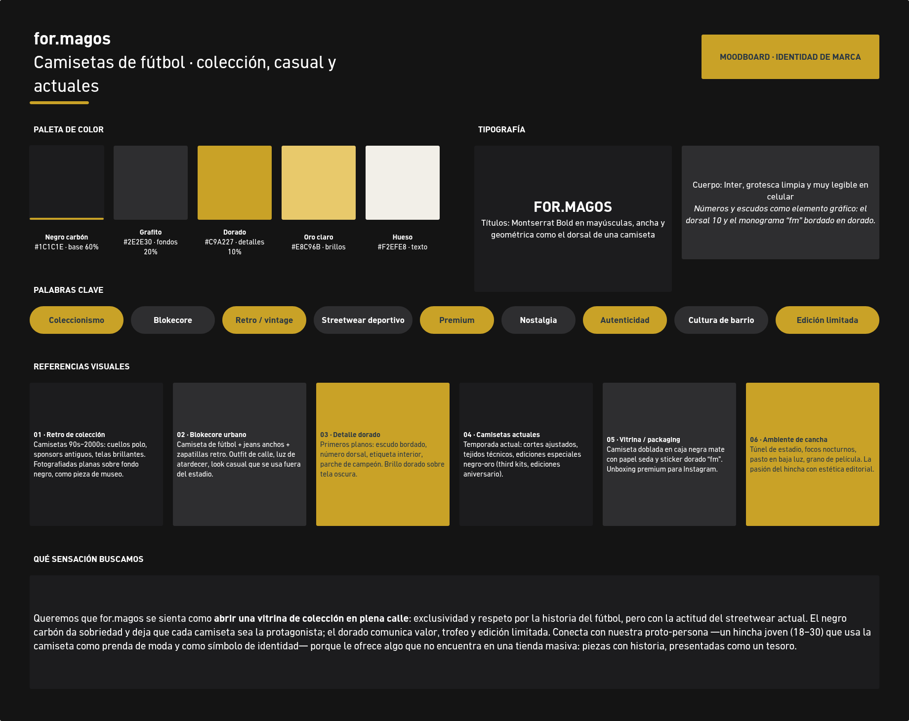

**Tablero en Whimsical:** https://whimsical.com/moodboard-for-magos-M8uf1mnFJNpVcTd2v5zocp

## Palabras clave
Coleccionismo · Blokecore · Retro / vintage · Streetwear deportivo · Premium · Nostalgia · Autenticidad · Cultura de barrio · Edición limitada

## Qué sensación buscamos
Queremos que for.magos se sienta como abrir una vitrina de colección en plena calle: exclusividad y respeto por la historia del fútbol, con la actitud del streetwear actual.
El negro carbón da sobriedad y deja que cada camiseta sea la protagonista; el dorado comunica valor, trofeo y edición limitada.
Conecta con nuestra proto-persona, un hincha joven (18–30) que usa la camiseta como prenda de moda y como símbolo de identidad,
porque le ofrece algo que no encuentra en una tienda masiva: piezas con historia, presentadas como un tesoro.
