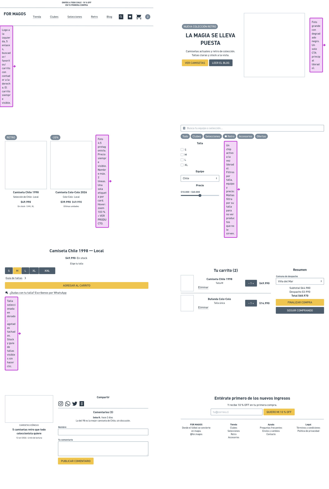

# Componentes — For Magos

> Guía: [Componentes](../evaluacion/guias/fase-2-specs/03-calco-de-componentes.md)

**Tablero en Whimsical:** https://whimsical.com/2m7r88cmjJYw4A2qijY5xp

Cada componente se calcó de un sitio de referencia y se adaptó a For Magos. El nombre entre paréntesis es el que usa el [`DESIGN.md`](../DESIGN.md).

| Componente | Parte del sitio | Referencia | Qué contiene | Qué necesidad de Matías resuelve |
|---|---|---|---|---|
| 1. Navbar + barra de anuncio (`navbar`, `announcement-bar`) | Todo el sitio | nike.com | Barra dorada con "Envíos a todo Chile · 10 % OFF", logo, enlaces Tienda, Clubes, Selecciones, Retro y Blog, buscador, favoritos y carrito con contador. | Llega desde Instagram y necesita orientarse rápido. El carrito siempre visible evita su frustración de "procesos de compra demasiado largos". |
| 2. Hero (`hero`) | Landing | adidas.cl | Etiqueta "Nueva colección retro", título "La magia se lleva puesta", bajada, botón dorado "Ver camisetas" y botón secundario "Leer el blog", foto grande. | Le muestra en un vistazo qué vende For Magos (actuales + retro) y le da un solo camino claro hacia la tienda. |
| 3. Product card + etiquetas (`card-product`, `tag-offer`, `tag-new`, `tag-last-units`) | Tienda y landing | classicfootballshirts.co.uk | Foto 4:5, etiqueta (Retro, -20 %), nombre, equipo, precio (y precio anterior), stock y tallas disponibles. | Necesita ver precio, talla y disponibilidad sin entrar al producto, y fotos que muestren bien la camiseta. |
| 4. Buscador + chips + filtros (`search-bar`, `chip-filter`) | Tienda | adidas.cl | Buscador "Busca tu equipo o selección…", chips Todo/Clubes/Selecciones/Retro/Accesorios/Ofertas y filtros por talla, equipo y precio. | Quiere encontrar la camiseta de su equipo rápido y filtrar solo su talla. |
| 5. Selector de talla + stock (`size-selector`, `tag-stock`, `whatsapp-link`) | Ficha de producto | nike.com | Nombre, precio, "En stock", tallas S–XXL (agotadas tachadas), guía de tallas, botón "Agregar al carrito" a todo el ancho y enlace a WhatsApp. | Su frustración principal: no encontrar información de tallas o stock. Aquí todo está a la vista y, si duda, puede escribir por WhatsApp. |
| 6. Carrito (`cart-item`, `order-summary`) | Carrito | nike.com | Ítems con miniatura, talla, cantidad, precio y "Eliminar"; resumen con comuna de despacho, subtotal, despacho, total y botones "Finalizar compra" / "Seguir comprando". | Quiere comprar sin sorpresas: ve el costo de despacho y el total antes de pagar. |
| 7. Card de artículo + compartir + comentarios (`card-article`, `share-bar`, `comment-box`) | Blog y artículo | blog de classicfootballshirts.co.uk | Foto, categoría, título, fecha y tiempo de lectura; íconos de Instagram, WhatsApp, X y copiar enlace; lista de comentarios y formulario. | Lo motiva coleccionar camisetas históricas: lee la historia, la comparte con sus amigos hinchas y opina. |
| 8. Newsletter + footer (`newsletter-form`, `footer`) | Landing y todo el sitio | unisport.dk | Título "Entérate primero de los nuevos ingresos", input de correo y botón "Quiero mi 10 % OFF"; footer con logo, frase, columnas Tienda/Ayuda/Legal e Instagram. | Quiere enterarse primero cuando llegan camisetas nuevas o retro (captación de leads) y encontrar ayuda (FAQ, envíos, cambios) cuando la necesita. |
