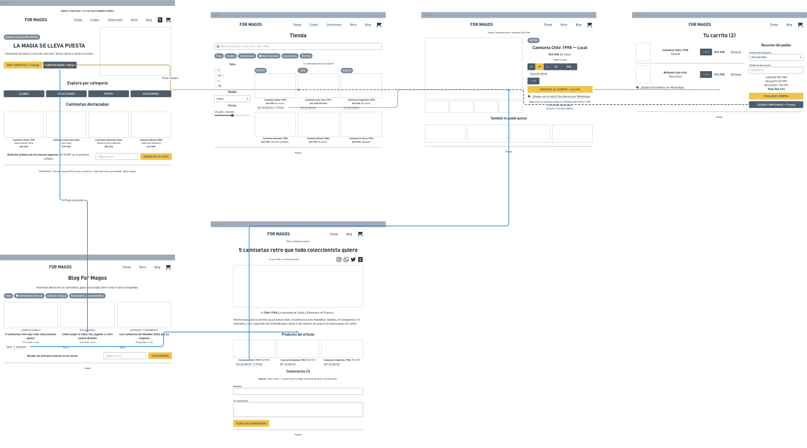

# Spec de diseño — For Magos

> Guía: [Spec de diseño](../evaluacion/guias/fase-2-specs/06-spec-de-diseno.md)

La spec de diseño tiene dos partes:

1. **[`DESIGN.md`](../DESIGN.md)** (en la raíz): el design system de For Magos, en el formato que Stitch importa. Validado con `npx @google/design.md lint DESIGN.md` → **0 errores, 0 advertencias**.
2. **Este documento:** las 6 pantallas, escritas como prompts listos para pegar en Stitch.

**Wireframes en Whimsical:** https://whimsical.com/NKSrQkUWc47Yt8ZaTY5KZC

> Guía de wireframes: [Wireframes](../evaluacion/guias/fase-2-specs/04-wireframes.md)



Las flechas doradas son el **flujo de compra** (Landing → Tienda → Ficha → Carrito) y las azules el **flujo de contenido** (Landing → Blog → Artículo → Ficha), tal como están en [`05-arquitectura.md`](05-arquitectura.md).

### Funcionalidades en los wireframes

| Funcionalidad | Pantalla |
|---|---|
| Captación de leads (correo + 10 % OFF) | Landing, Blog |
| Navegar artículos por categoría | Blog |
| Comentar y compartir un artículo | Artículo |
| Buscar y filtrar (talla, equipo, precio) | Tienda |
| Ver detalle, elegir talla y agregar al carrito | Ficha de producto |
| Ver stock y etiquetas de oferta | Tienda, Ficha de producto |
| Guía de tallas y consulta por WhatsApp | Ficha de producto, Carrito |
| Costo de despacho y total antes de pagar | Carrito |
| Productos del artículo | Artículo |

## Pantallas

### 1. Landing

```text
Pantalla: Landing de For Magos, versión desktop (1440px). Usa el design system del proyecto (fondo negro carbón #0B0B0B, acentos dorados #C6A15B, Montserrat en títulos e Inter en textos).
Objetivo: que Matías, que llega desde Instagram, entienda en segundos que For Magos vende camisetas actuales y retro de colección y entre a la tienda.
Componentes, de arriba hacia abajo:
1. announcement-bar: "ENVÍOS A TODO CHILE · 10 % OFF EN TU PRIMERA COMPRA".
2. navbar: logo "FOR MAGOS"; nav-link Tienda, Clubes, Selecciones, Retro, Blog; íconos de búsqueda, favoritos y carrito con contador "2".
3. hero: foto de una camiseta retro de Chile con degradado negro. Etiqueta tag-new "NUEVA COLECCIÓN RETRO", h1 "LA MAGIA SE LLEVA PUESTA", bajada "Camisetas actuales y retro de colección. Tallas claras y stock a la vista.", button-primary "VER CAMISETAS" y button-secondary "LEER EL BLOG".
4. h2 "Explora por categoría" y 4 card-category en una fila: CLUBES, SELECCIONES, RETRO, ACCESORIOS.
5. h2 "Camisetas destacadas" y 4 card-product: Camiseta Chile 1998 (tag "RETRO") $49.990; Camiseta Colo-Colo local 2026 (tag-offer "-20%") $39.990 antes $49.990; Camiseta Argentina local 2026 (tag-new "NUEVO") $54.990; Camiseta Brasil 2002 (tag-last-units "ÚLTIMAS UNIDADES") $47.990.
6. Banda de 3 beneficios con ícono: "Envíos a todo Chile", "Cambios de talla gratis", "Pago seguro".
7. newsletter-form: título "Entérate primero de los nuevos ingresos", texto "Y recibe 10 % OFF en tu primera compra.", input-field "tu@correo.cl" y button-primary "QUIERO MI 10 % OFF".
8. footer: "FOR MAGOS · Donde el fútbol se convierte en magia.", columnas Tienda / Ayuda / Legal, Instagram @for.magos y métodos de pago.
```

### 2. Tienda

```text
Pantalla: Tienda de For Magos, versión desktop (1440px). Usa el design system del proyecto.
Objetivo: que Matías encuentre rápido la camiseta de su equipo, en su talla, viendo precio y stock sin entrar al producto.
Componentes, de arriba hacia abajo:
1. navbar (nav-link-active en "Tienda").
2. h1 "Tienda" y search-bar a todo el ancho con el placeholder "Busca tu equipo o selección…".
3. Fila de chip-filter: Todo, Clubes, Selecciones, Retro (chip-filter-active), Accesorios, Ofertas.
4. A la izquierda, columna de filtros de 240px: "Talla" (checkbox S, M marcada, L, XL, XXL), "Equipo" (desplegable "Todos") y "Precio" (rango $10.000 – $60.000). A la derecha, texto "12 camisetas retro en talla M" y grilla de 4 columnas con 8 card-product:
   Camiseta Chile 1998 $49.990 (tag "RETRO", En stock); Camiseta Colo-Colo 1991 $44.990 antes $55.990 (tag-offer "-20%"); Camiseta Argentina 1986 $52.990 (tag-new "NUEVO"); Camiseta Holanda 1988 $49.990 (tag-last-units "ÚLTIMAS UNIDADES"); Camiseta Brasil 2002 $47.990; Camiseta Alemania 1990 $49.990; Camiseta Italia 2006 $46.990; Camiseta Francia 1998 $49.990 (agotada: foto en gris y texto "Agotado").
5. Paginación "1 2 3 Siguiente".
6. footer.
```

### 3. Ficha de producto

```text
Pantalla: Ficha de producto de For Magos, versión desktop (1440px). Usa el design system del proyecto.
Objetivo: que Matías confirme que la camiseta es la que busca, elija su talla con seguridad y la agregue al carrito.
Componentes, de arriba hacia abajo:
1. navbar.
2. Migas de pan: "Tienda / Camisetas retro / Camiseta Chile 1998".
3. Dos columnas. Izquierda (60 %): foto grande 4:5 de la camiseta y 4 miniaturas (frente, espalda, detalle del escudo, etiqueta). Derecha (40 %):
   - tag "RETRO";
   - h1 "Camiseta Chile 1998 — Local";
   - price "$49.990" y tag-stock "En stock";
   - texto "Elige tu talla" y size-selector S, M (size-selector-active), L, XL, XXL (size-selector-disabled, tachada);
   - enlace "Guía de tallas";
   - selector de cantidad "− 1 +";
   - button-primary "AGREGAR AL CARRITO" a todo el ancho;
   - whatsapp-link "¿Dudas con tu talla? Escríbenos por WhatsApp";
   - descripción: "Réplica de la camiseta usada por la Selección en el Mundial de Francia 1998. Corte retro, tela liviana y escudo bordado." y "Envío en 2 a 4 días hábiles · Cambios de talla gratis".
4. h2 "También te puede gustar" y 4 card-product: Camiseta Chile 2026 $54.990, Camiseta Colo-Colo 1991 $44.990, Camiseta Argentina 1986 $52.990, Bufanda Selección Chile $14.990.
5. footer.
```

### 4. Carrito

```text
Pantalla: Carrito de For Magos, versión desktop (1440px). Usa el design system del proyecto.
Objetivo: que Matías revise su pedido y sepa el total con despacho antes de pagar, sin sorpresas.
Componentes, de arriba hacia abajo:
1. navbar (contador del carrito "2").
2. h1 "Tu carrito (2)".
3. Dos columnas. Izquierda: 2 cart-item:
   - Camiseta Chile 1998, talla M, cantidad "− 1 +", $49.990, enlace "Eliminar";
   - Bufanda Colo-Colo, talla única, cantidad "− 1 +", $14.990, enlace "Eliminar".
   Debajo, whatsapp-link "¿Dudas? Escríbenos por WhatsApp".
   Derecha: order-summary con título "Resumen del pedido", desplegable "Comuna de despacho: Viña del Mar", input-field "Código de descuento: MAGOS10", líneas Subtotal $64.980, Despacho $3.990, Descuento −$6.498 y Total $62.472 en price; button-primary "FINALIZAR COMPRA" y button-secondary "SEGUIR COMPRANDO".
4. Banda "Te puede interesar" con 4 card-product pequeñas.
5. footer.
```

### 5. Blog

```text
Pantalla: Blog de For Magos, versión desktop (1440px). Usa el design system del proyecto.
Objetivo: que Matías encuentre historias sobre camisetas que le interesan y entre a leer una.
Componentes, de arriba hacia abajo:
1. navbar (nav-link-active en "Blog").
2. h1 "Blog For Magos" y bajada "Historias detrás de las camisetas, guías para elegir bien y todo lo que va llegando."
3. Fila de chip-filter: Todo, Camisetas icónicas (chip-filter-active), Guía de compra, Novedades y lanzamientos.
4. Grilla de 3 columnas con 6 card-article (foto 16:9, categoría en dorado, título, fecha y tiempo de lectura):
   "5 camisetas retro que todo coleccionista quiere" (Camisetas icónicas, 12 oct 2026, 4 min);
   "Cómo elegir tu talla: fan, jugador y retro calzan distinto" (Guía de compra, 5 oct 2026, 3 min);
   "Las camisetas del Mundial 2026 que ya llegaron" (Novedades y lanzamientos, 28 sep 2026, 3 min);
   "La historia de la camiseta de Colo-Colo campeón 1991" (Camisetas icónicas, 20 sep 2026, 5 min);
   "Cómo cuidar tus camisetas de colección" (Guía de compra, 12 sep 2026, 3 min);
   "Third kits: las camisetas más raras de la temporada" (Novedades y lanzamientos, 5 sep 2026, 4 min).
5. newsletter-form: "Recibe los artículos nuevos en tu correo", input-field "tu@correo.cl" y button-primary "SUSCRIBIRME".
6. footer.
```

### 6. Artículo

```text
Pantalla: Artículo del blog de For Magos, versión desktop (1440px). Usa el design system del proyecto.
Objetivo: que Matías lea la historia, la comparta con sus amigos hinchas y llegue al producto del que habla el artículo.
Componentes, de arriba hacia abajo:
1. navbar.
2. Columna de lectura de 720px centrada: migas "Blog / Camisetas icónicas", h1 "5 camisetas retro que todo coleccionista quiere", fecha "12 oct 2026 · 4 min de lectura" y share-bar (Instagram, WhatsApp, X, copiar enlace).
3. Foto principal 16:9 de camisetas retro colgadas sobre fondo negro.
4. Cuerpo del artículo con 5 subtítulos h2: "1. Chile 1998", "2. Holanda 1988", "3. Argentina 1986", "4. Colo-Colo 1991", "5. Brasil 2002", cada uno con un párrafo breve.
5. h2 "Productos del artículo" y 3 card-product: Camiseta Chile 1998 $49.990, Camiseta Holanda 1988 $49.990, Camiseta Argentina 1986 $52.990, cada una con button-secondary "VER PRODUCTO".
6. share-bar repetida al final.
7. comment-box: h2 "Comentarios (3)", comentario de "Seba R. · hace 2 días: La del 98 es la mejor camiseta de Chile, sin discusión.", formulario con input-field "Nombre", área "Tu comentario" y button-primary "PUBLICAR COMENTARIO".
8. footer.
```

### Versión mobile (para cada pantalla)

```text
Genera la versión mobile (375px de ancho) de esta pantalla siguiendo la sección Layout del design system:
- navbar con logo, ícono de búsqueda, carrito con contador y menú hamburguesa (los nav-link van dentro del menú);
- márgenes laterales de 16px y 48px entre secciones;
- grilla de productos de 2 columnas; card-article en 1 columna;
- en la tienda, los filtros se ocultan detrás de un button-secondary "FILTRAR" y los chip-filter se desplazan en horizontal;
- en la ficha de producto, la galería va arriba y el button-primary "AGREGAR AL CARRITO" queda fijo al fondo de la pantalla;
- en el carrito, el order-summary va debajo de los productos y el total queda fijo al fondo con "FINALIZAR COMPRA";
- hero con la foto arriba y el texto debajo, h1 de 32px;
- botones y áreas táctiles de mínimo 44px de alto.
Mantén los mismos textos, colores y componentes de la versión desktop.
```
